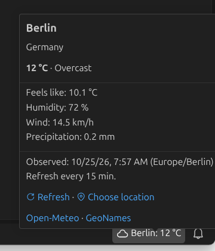
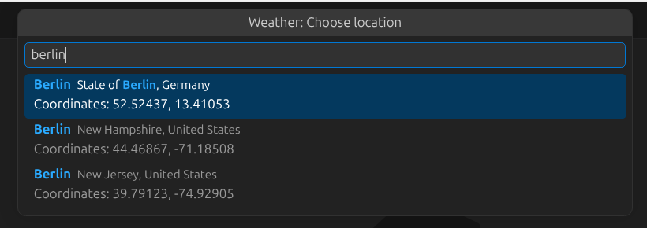

# Weather for VS Code

See the current weather for your location on the right side of the status bar.
Hover to view weather conditions, feels-like temperature, humidity, wind speed,
precipitation, and the observation time in the location's time zone.



*The extension running in VS Code's dark theme, using example weather data.*

## Getting started

1. Run `npm install` and `npm run compile`.
2. Open the project in VS Code and press **F5** (the **Run Extension** configuration).
3. In the Extension Development Host, click **Weather: Set location**.
4. Type a city or postal code (at least two characters), for example `Berlin`.
5. Choose a result using its region, country, and coordinates to distinguish
   places with the same name. Press **Escape** to cancel without changing the location.

The status bar then shows a weather icon and a value such as `Berlin: 12 °C`.
Settings changes take effect immediately without restarting.



*The native location picker in VS Code, using example search results. Compare
regions, countries, and coordinates to choose the intended place.*

## Create a VSIX package

A VSIX file is an installable extension package that you can share and install
locally. To build it, install Node.js 22 or later with npm, and open a terminal
in the project directory.

Optionally, add a `publisher` identifier to `package.json` for a named extension
identity, for example:

```json
"publisher": "local-weather"
```

Together with `name`, it identifies the extension as `<publisher>.weather`;
keep it unchanged when building updates. The current development manifest can
also be packaged locally without this field. A Marketplace account or access
token is not needed for local packaging and installation.

Install the project dependencies and create the package:

```sh
npm install
npx --yes @vscode/vsce package --out weather.vsix --no-rewrite-relative-links
```

The packaging command runs `vscode:prepublish`, which compiles the TypeScript
code automatically, and writes `weather.vsix` to the project directory. It
includes runtime dependencies and both language catalogs according to
`.vscodeignore`. The `--yes` option lets npm download the packaging tool without
a global installation; it does not answer prompts from `vsce`. The
`--no-rewrite-relative-links` option keeps the screenshot and license links local
so they work in the installed package without needing a hosted image.

The package includes the project's MIT license. See the official
[VS Code packaging documentation](https://code.visualstudio.com/api/working-with-extensions/publishing-extension)
for packaging and publishing options.

## Manual installation

After a tagged build finishes, download its VSIX from
[GitHub Releases](https://github.com/denga/vscode-weather-extension/releases).
Release files are named `weather-v<version>.vsix`; use the downloaded file name
in place of `weather.vsix` in the instructions below.

You need VS Code **1.140.0 or later** and a `weather.vsix` file, either built using
the steps above or received from someone else. Node.js and the source code are
only needed to build the package, not to install or use it.

### Install using the VS Code interface

1. Open VS Code and the **Extensions** view.
2. Open the **…** menu and select **Install from VSIX…**. Alternatively, run
   **Extensions: Install from VSIX…** from the Command Palette.
3. Select `weather.vsix` and wait for installation to finish.
4. Reload VS Code if prompted.
5. Run **Weather: Choose location**, search for your city, and select a result.

### Install using the command line

With the VS Code `code` command available on your PATH, run:

```sh
code --install-extension ./weather.vsix
```

You can also use an absolute path; quote it if it contains spaces. If `code` is
not available, use the interface steps above. Reload VS Code if prompted, then
configure your location as described above.

To update a manually installed copy, build or obtain the new VSIX and install it
again using either method. VSIX installations have automatic updates disabled
by default. For command-line reinstalls, use:

```sh
code --install-extension ./weather.vsix --force
```

See the official [VSIX installation instructions](https://code.visualstudio.com/docs/configure/extensions/extension-marketplace#_install-from-a-vsix).

## Languages

The extension supports **English and German** and follows the VS Code display
language. Commands, settings descriptions, status messages, weather conditions,
tooltips, and accessibility labels are localized. Numbers and dates use the
corresponding English or German format; location names are requested in that
language as well. Other display languages fall back to English.

Use **Configure Display Language** in the Command Palette to change the VS Code
language, then restart VS Code when prompted. The documentation is in English.

## Settings

| Setting | Default | Description |
| --- | --- | --- |
| `weather.location` | empty | City name, optionally followed by a country or region after a comma. The first match is used; hover to see the resolved location, region, and country. Leave empty to stop weather requests. |
| `weather.refreshInterval` | `15` | Automatic refresh interval, from 5 to 120 minutes. |

Example user or workspace settings (`settings.json`):

```json
{
  "weather.location": "Berlin, DE",
  "weather.refreshInterval": 15
}
```

Temperature is shown in °C, wind speed in km/h, and precipitation in mm.
Precipitation covers the weather service's current measurement interval,
not a daily total. Weather data represents model-based current conditions.

Click the weather display to refresh. The hover groups the current temperature
and conditions, measurements, observation time, and data sources. Its
**Refresh** and **Choose location** links provide direct access to both actions.
The Command Palette provides **Weather: Refresh now**, **Weather: Choose
location**, and **Weather: Open settings**. You can still edit `weather.location`
manually; the first search result is used in that case.

The location picker remembers selected coordinates locally, keyed by the saved
location text, so refreshes and VS Code restarts use the exact place you selected,
including in windows without an open folder. It reuses an existing
workspace location setting when present; otherwise it saves the location in user
settings. Clearing `weather.location` stops requests.

During a refresh, the last successful reading stays visible. If a network request
fails, that reading is retained for the same location and marked **Stale**, with
the failure reason and last successful refresh time on hover. Click to retry;
a successful refresh removes the warning. This cache is kept only for the current
extension session. Switching locations, invalid service responses, or an unknown
location clear the previous reading. Without a cached reading, a failure shows
**Weather unavailable**.

## Data sources and privacy

The extension uses [Open-Meteo](https://open-meteo.com/) and its
[geocoding API](https://open-meteo.com/en/docs/geocoding-api), based on
[GeoNames](https://www.geonames.org/). No API key is required.
The public API is intended for non-commercial use; see the
[Open-Meteo terms](https://open-meteo.com/en/terms).
Weather data is licensed under [CC BY 4.0](https://creativecommons.org/licenses/by/4.0/).

The configured location name is sent to `geocoding-api.open-meteo.com`, and
the resolved coordinates are sent to `api.open-meteo.com`.
The extension does not detect your device's location or collect telemetry.
An internet connection is required. Requests are cancelled when the location
changes or the extension is deactivated. Timeouts and limited retries prevent
indefinite loading.

## Development and testing

- `npm run compile` — compile TypeScript.
- `npm run watch` — compile during development.
- `npm run lint` — run ESLint.
- `npm test` — run compilation, lint, and tests in a real VS Code extension host.

Tests cover the status bar, tooltips, settings changes, errors, and cancelled or
late requests. HTTP tests use a local test server and do not require a reachable
weather service. The test runner downloads a compatible VS Code version by
default. Set `VSCODE_EXECUTABLE_PATH` to use an existing installation, such as
`/usr/share/code/code` on Linux.

Run `npm run test:languages` to test English, German, and the English fallback
for an unsupported display language. Runtime translations are in `l10n/`;
command and settings translations are in `package.nls*.json`.

## GitHub Actions and releases

The [CI workflow](https://github.com/denga/vscode-weather-extension/blob/main/.github/workflows/ci.yml) runs on branch pushes, pull requests,
and manual runs from the Actions tab. It installs dependencies with `npm ci`,
compiles and lints the extension, and runs the extension-host tests in English,
German, and French (to check the English fallback). Linux tests use a virtual
display provided by `xvfb-run`.

Pushing a tag beginning with `v` also runs the tests. After they pass, the release
job checks that the tag exactly matches `v` followed by the version in
`package.json`, creates the VSIX, and attaches it to a GitHub Release. For example,
version `0.0.1` requires tag `v0.0.1` and produces `weather-v0.0.1.vsix`.

To create the first release after committing the workflow:

```sh
git push origin main
git tag v0.0.1
git push origin v0.0.1
```

For later releases, update the version in `package.json` and `package-lock.json`
(for example with `npm version patch --no-git-tag-version`), update the changelog,
and commit those changes before creating and pushing the matching tag.

Tags such as `v0.1.0-beta.1` are marked as prereleases. Re-running a tag workflow
uploads the VSIX to the existing release and replaces an asset with the same name.
Publication uses GitHub's automatic `GITHUB_TOKEN`; no additional secret or
Marketplace account is required. Only the release job has `contents: write`
permission. This workflow distributes VSIX files through GitHub Releases.

## License

The extension's source code and documentation are licensed under the
[MIT License](LICENSE.txt). Weather and location data retain their respective
provider licenses; see [Data sources and privacy](#data-sources-and-privacy).
